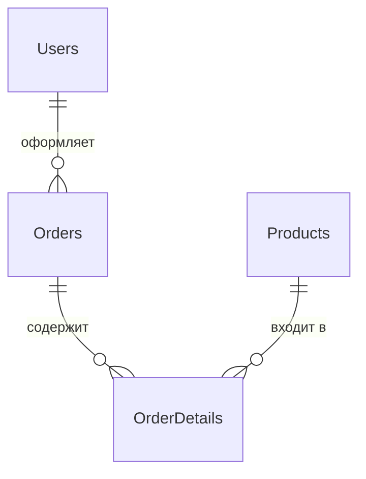

# Создание виртуальной базы данных магазина в PostgreSQL

Домашнее задание курса C# Developer. Professional OTUS.

## Файлы

| Файл | Содержание |
| --- | --- |
| [01_create_tables.sql](01_create_tables.sql) | Четыре таблицы, ключи, связи, ограничения и индексы |
| [02_queries.sql](02_queries.sql) | Тестовые данные и семь пронумерованных запросов из задания |

Решение выполнено на SQL. Приложение на C# и Entity Framework для этого задания не требуются.

## Порядок запуска

Требуется установленный PostgreSQL. Через pgAdmin создайте **новую пустую базу**
`homework_otus_shop`, подключитесь к ней и откройте Query Tool:

1. Откройте и выполните целиком `01_create_tables.sql`.
2. Откройте и выполните целиком `02_queries.sql`.
3. Посмотрите результаты SELECT и RETURNING.

Либо выполните команды из папки репозитория:

```sh
createdb -U postgres homework_otus_shop
psql -U postgres -d homework_otus_shop -v ON_ERROR_STOP=1 -f 01_create_tables.sql
psql -U postgres -d homework_otus_shop -v ON_ERROR_STOP=1 -f 02_queries.sql
```

Каждый файл выполняется **один раз**. Демонстрационные данные рассчитаны на
идентификаторы, начинающиеся с 1 в новой базе. Повторное выполнение второго файла
в той же базе не поддерживается: Email уникален. Для повторной демонстрации
создайте новую пустую учебную базу и снова выполните оба файла.
Для своих данных запускайте нужные запросы отдельно, подставляя реальные ID.

## Схема связей



| Таблица | Первичный ключ | Внешние ключи |
| --- | --- | --- |
| Products | ProductID | — |
| Users | UserID | — |
| Orders | OrderID | UserID → Users.UserID |
| OrderDetails | OrderDetailID | OrderID → Orders.OrderID; ProductID → Products.ProductID |

ID генерируются автоматически. Цена, остаток и стоимость позиции неотрицательны;
количество в позиции положительно. Email уникален, даты регистрации и заказа
проставляются автоматически. Внешние ключи запрещают удаление записей, на которые
ссылаются зависимые строки.

## Демонстрация запросов

Во втором файле создаются шесть товаров, два пользователя, три заказа и четыре
позиции заказов. У Ивана два заказа, у Анны один.

Ожидаемые результаты после последовательного выполнения файла на новой базе:

| № | Требование | Ожидаемый результат |
| --- | --- | --- |
| 1 | Добавление продукта | Добавлены 6 товаров; RETURNING показывает их ID и цены |
| 2 | Обновление цены | Клавиатура: 2500 → 2700 |
| 3 | Заказы пользователя | Для UserID = 1 возвращаются заказы 2 и 1 |
| 4 | Стоимость заказа | Для OrderID = 1: 6200 = 2 × 2500 + 1200 |
| 5 | Количество товаров на складе | 42 единицы |
| 6 | Пять самых дорогих | Монитор, принтер, веб-камера, наушники, клавиатура |
| 7 | Остаток менее 5 | Принтер — 0; монитор — 3; веб-камера — 4 |

`TotalCost` — стоимость всей позиции на момент покупки. При создании позиции
запрос сохраняет `Price * Quantity`. После изменения цены товара стоимость
старого заказа остается прежней; повторно умножать TotalCost на Quantity не нужно.

Складской остаток в этом задании хранится отдельно: добавление позиции заказа
автоматически его не уменьшает. Запрос № 5 суммирует единицы товаров,
а не количество наименований. При равной цене запрос № 6 сортирует по ProductID.

Для существующего заказа без позиций запрос № 4 возвращает 0.
Для отсутствующего заказа он не возвращает строку.
Имена таблиц и столбцов взяты из задания и используются в двойных кавычках.

## Проверка и статус

Структура, порядок вставки данных, связи и ожидаемые результаты проверены вручную.
Запуск на PostgreSQL в среде подготовки не выполнялся: сервер и клиент отсутствуют.
Таблица выше содержит ожидаемые результаты, а не отчет о выполненном запуске.

## Примеры оформления аналогичного ДЗ

Изучены публичные решения того же задания:

- [T1m-cpp — ДЗ2](https://github.com/T1m-cpp/Otus.CSharp.Developer.Professional/tree/main/ДЗ2):
  два SQL-файла, тестовые данные и демонстрация запросов в README.
- [Alexandr163r — Homework_2](https://github.com/Alexandr163r/Otus_HomeWork.NET/blob/main/HomeWork/Homework_2.md):
  SQL создания таблиц, семь запросов и схема БД.
- [yuskinaAA — queries.sql](https://github.com/yuskinaAA/otus-cPro-yuskinaAA/blob/main/HW-02%20sql%20scripts/queries.sql):
  пронумерованные запросы и тестовые данные.

Использован аналогичный формат оформления: схема, запросы, данные и пояснения.
SQL и набор данных написаны для этого репозитория.
Наличие публичного решения не подтверждает его принятие преподавателем.
